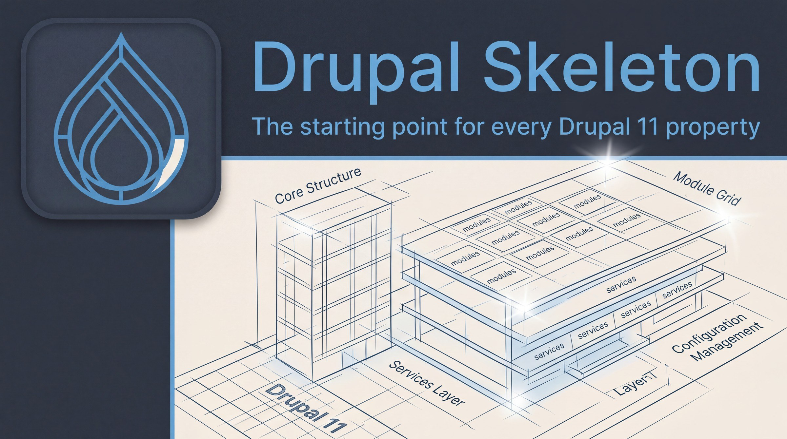

# drupal-skeleton

A starting point for any Drupal 11 module or theme intended to live —
contrib-grade, test-covered, DDEV-housed from day one.

The skeleton holds the cross-cutting *foundation* that earns its
place on every new Drupal project: the DDEV stack, the composer
baseline, the autoload conventions, the docs/decision-log scaffold,
and a running inventory of battle-scars in `docs/BATTLE_SCARS.md`.
Project-shaped specifics (DB vendor, AI providers, JS pipeline,
domain schemas) are deliberately **not** here — those are decisions
the next project makes for itself.

## What's in the box

```
drupal-skeleton/
├── .ddev/config.yaml                 ← PHP 8.4, MariaDB 11.4, apache-fpm (= prod image), mutagen, Composer 2, Node 22
├── .github/workflows/
│   ├── build-and-push.yml            ← the production pipeline: gate (or its reuse) → audit → image → GHCR → deploy → HTTP health gate
│   ├── test-gate.yml                 ← scripts/ci/tests.sh on every PR, and the gate the other workflows call
│   ├── upstream-sync.yml             ← weekly: proposes the upstream's latest to a site as a gated PR
│   └── security-scan.yml             ← the one weekly security run: composer audit of the lock + passive ZAP baseline
├── Dockerfile / .dockerignore        ← multi-stage production image (drupal:11-php8.4-apache, composer --no-dev, drush on PATH)
├── deploy/
│   ├── docker-compose.yaml           ← host-side stack (drupal + mariadb, Traefik labels), fully .env-interpolated
│   ├── .env.example                  ← every key the stack + image read; copy to .env on the host
│   ├── settings.prod.php             ← tracked production settings.php, 100% env-driven, baked into the image
│   └── entrypoint.sh                 ← fixes bind-mount ownership on start; no manual chown on first deploy
├── scripts/setup_mail.php            ← idempotent: SMTP transport + /contact form, all secrets from env
├── config/sync/                      ← exported config = deploy source of truth (`drush deploy` imports it)
├── composer.json                     ← Drupal 11.4 + drush + devel; min-stability dev + prefer-stable; PSR-4 autoload
├── phpunit.xml.dist                  ← unit suite, ready for `ddev exec ../vendor/bin/phpunit`
├── docs/
│   ├── PROTOCOL.md                   ← DDEV-only working principle + decision-log scaffold
│   ├── DEPLOY.md                     ← the repo ↔ CI ↔ host deploy contract
│   └── BATTLE_SCARS.md               ← lessons that earn permanent residence
├── web/modules/custom/example_module/   ← contrib-grade module template
├── web/modules/upstream/ad_inventory/   ← banner spaces that keep the page cache, filled after ad consent (PROTOCOL D32)
├── web/modules/upstream/ga4_report/     ← GA4 visits report in the admin (upstream-owned; PROTOCOL D24)
├── web/modules/upstream/image_fallback/ ← logo (or a file) in place of an empty image/media field (upstream-owned)
├── web/modules/upstream/managing_admins/ ← the host-listed managing admins exist on every site (upstream-owned; PROTOCOL D29)
└── web/themes/custom/example_theme/     ← Olivero-child theme template
└── optional/vite-bundle/             ← drop-in for themes that want a modern JS pipeline
```

The module and the theme are independent — keep one, both, or
neither (delete the directory; nothing else references it).

### Production deploy, by construction

The skeleton is opinionated about how a site reaches production: the
Dockerfile, the host compose stack, the env-driven `settings.php`, and the
build → push → deploy → health-gate workflow all ship here and are meant to
be used **unchanged** — per-property values live in the host `.env` and in
three GitHub Actions settings (`PROD_URL`, `DEPLOY_HOST`, `VPS_DEPLOY_KEY`).
Until those exist, every push still audits, builds and pushes the image, so
the Dockerfile is proven in CI from the first commit. The full contract is in
[docs/DEPLOY.md](docs/DEPLOY.md).

### Inherited security gate

Every property minted from the skeleton is audited **by construction**, not by
remembering to bolt an audit step onto its workflows later. `composer audit
--no-dev --locked` runs in two places:

- **in `build-and-push.yml`, before every image**: a lock carrying a known
  advisory in a production dependency is never built, so never deployed. It is
  the only audit on a push; a lock change is audited once;
- **weekly, in `security-scan.yml`**, so an advisory published *after* code
  merged is surfaced (a failed scheduled run notifies the repo owner) without
  waiting for someone to touch composer by chance. The same job runs the ZAP
  baseline: one weekly security run, one runner.

An upstream sync also audits its re-resolved lock before it proposes it. Until
2026-11-15 a separate `composer-audit.yml` audited every lock change on its PR
and its push as well; it cost a runner per run and repeated the build's audit.

### Health baseline

A fresh clone passes all four, inside DDEV, before its first commit — and so
should every project minted from it, before every push:

```bash
ddev exec composer audit --locked                       # incl. dev deps
ddev exec composer lint                                 # phpcs + phpstan: 0 errors, 0 warnings
ddev exec vendor/bin/phpunit --testsuite=unit --display-deprecations
ddev exec node -v                                       # a supported LTS line
```

When the weekly audit turns red, remember it is fleet-wide (BATTLE_SCARS §20):
bump the lock in every property that shares the ancestry, not only here.

## Quickstart

```bash
# 1. Clone or rsync this skeleton, rename (replace 'mythingname' with yours).
cp -r drupal-skeleton/ ~/tecnocratica/projects/mythingname/
cd ~/tecnocratica/projects/mythingname/

# 2. Edit composer.json's "name" field, .ddev/config.yaml's project name,
#    and rename web/modules/custom/example_module → my_module (or delete it),
#    rename web/themes/custom/example_theme → my_theme (or delete it).
#    Inside renamed module/theme, search-replace machine names everywhere:
#      example_module → my_module      (file names + .info.yml + namespaces)
#      example_theme  → my_theme       (likewise)
#      ExampleModule  → MyModule       (PHP class names + namespaces)
#      ExampleTheme   → MyTheme        (likewise)

# 3. Boot the testbed.
ddev start
ddev composer install
# The fleet profile (docs/INSTALL_PROFILES.md); --locale is the site language.
ddev drush si skeleton_site --locale=es --account-name=admin --account-pass=admin -y
ddev drush recipe ../recipes/appointments   # one recipe per feature it needs
ddev drush en my_module my_theme -y      # whichever you kept
# Pin config export at the tracked dir — DDEV defaults it to
# sites/default/files/sync and the first export silently lands there
# (BATTLE_SCARS §23). Do this before any `drush config:export`:
echo "\$settings['config_sync_directory'] = '../config/sync';" >> web/sites/default/settings.php
ddev launch                              # opens the site

# 4. Develop. Tests:
ddev exec ../vendor/bin/phpunit                                  # PHP unit
ddev exec npm test    # if you copied optional/vite-bundle into place
```

## Working principle: DDEV-only

> All code operations (composer, npm, phpunit, vitest, drush) run
> inside DDEV. No bare-host fallback path.

This is non-negotiable. PHP versions, Node versions, ext-mongodb,
GD library quirks, locale settings — every "works on my machine"
trap dissolves once the only machine that exists is the DDEV
container. See `docs/PROTOCOL.md` for the rule, `docs/BATTLE_SCARS.md`
for the bodies that taught it.

## How to read the docs

- **`docs/PROTOCOL.md`** — the rules of engagement and the running
  decision log. Every architectural choice gets a one-paragraph
  entry (D1, D2, ..., E1, E2, ...) with the question, the chosen
  answer, and one line of reasoning. Future-you needs the *why*,
  not just the *what*.
- **`docs/BATTLE_SCARS.md`** — short paragraphs of "we learned this
  the hard way." Add to it whenever something costs more than 30
  minutes to figure out and the next person shouldn't have to
  re-learn it.

## What this skeleton is *not*

- Not a profile that builds a site. `skeleton_site` only keeps English on a
  non-English install from config; the site is its `config/sync`, and
  features are switched on by recipes (docs/INSTALL_PROFILES.md).
- Not opinionated about your data layer. Postgres, MariaDB,
  MongoDB-via-gateway, plain REST — decide for your project and
  document the choice in PROTOCOL.md.
- Not a frontend stack picker. The `optional/vite-bundle/` is for
  themes that want modern JS (Vite + TypeScript + Vitest); plenty
  of themes don't need it.
- Not a substitute for the `drupal-module-spawn` skill at
  `~/.claude/skills/drupal-module-spawn/SKILL.md`, which scaffolds
  short-lived *prototyping testbeds*. This skeleton is for things
  intended to outlast their first sprint.

